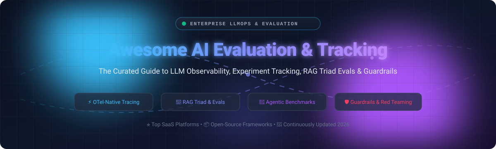

# ⚡ Awesome AI Evaluation & Tracking 🎯

  
  
  
  
  
  

**The Definitive Guide to LLM Observability, Prompt Evaluation, RAG Triad Benchmarks & AI Agent Experiment Tracking.**

*Curated ecosystem of enterprise SaaS platforms and battle-tested open-source frameworks for LLMOps, automated red-teaming, and production quality monitoring.*

---

> 🔍 **SEO & Search Keywords**: AI evaluation, LLM evaluation, LLMOps, RAG evaluation, LLM observability, experiment tracking, AI agent benchmarking, prompt evaluation, red teaming, hallucination detection, OpenTelemetry tracing.

**Last updated: October 2026** 📅

This repository tracks premier **enterprise SaaS platforms** 🏢 and **open-source projects** 🛠️ for **AI Evaluation & Tracking**. These frameworks empower engineering teams to systematically audit LLM applications—tracing step-by-step executions, scoring outputs with LLM-as-a-judge, benchmarking agentic workflows, and catching regressions before deployment.

- 🌟 **Enterprise Leaders**: Scale AI, Snorkel Flow, LangSmith, Braintrust, Fiddler AI, and Patronus AI.
- 🔓 **Open-Source Champions**: Langfuse, Promptfoo, Comet Opik, OpenAI Evals, DeepEval, Ragas, LM Evaluation Harness, and Arize Phoenix.

Contributions welcome! 🤝 Open a pull request to add or update tools.

---

## 📑 Table of Contents

- [📊 Sector Overview & Market Dynamics](#-sector-overview--market-dynamics)
- [🏢 SaaS & Hosted Platforms](#-saas--hosted-platforms)
- [🛠️ Open-Source GitHub Projects](#️-open-source-github-projects)
- [💡 How to Contribute](#-how-to-contribute)
- [☕ Support & Community](#-support--community)
- [📈 Star History](#-star-history)
- [⚖️ Disclaimer](#️-disclaimer)

## 📊 Sector Overview & Market Dynamics

The global AI evaluation, testing, and observability market is estimated at **$1.8B – $2.9B** (growing at a rapid CAGR of **23%–31%** through 2030+ as enterprise generative AI and autonomous agent adoption surges).
The market is currently **moderately fragmented transitioning into rapid consolidation**—characterized by a vibrant ecosystem of specialized evaluation and tracing startups, alongside aggressive acquisition runs by cloud platforms and observability giants (e.g., Meta's landmark investment in Scale AI, Snowflake acquiring TruEra, ClickHouse acquiring Langfuse, and OpenAI acquiring Promptfoo).

## 🏢 SaaS & Hosted Platforms

| Company / Product | Valuation / Revenue Scale | Pricing (Starting Paid Tier) | Free Tier / Trial Limits | Description |
| :--- | :--- | :--- | :--- | :--- |
| **[Scale AI](https://scale.com/)** | **$29.0B** valuation (~$2.0B ARR) | Custom enterprise quote (starts at ~$50,000/yr platform contracts; pay-as-you-go per-task unit rates) | **No public free tier**; Proof of Concept (PoC) / trial credits available upon sales consultation (historically ~200–1,000 labeling units in trial sandbox) | Comprehensive data engine for AI evaluation, RLHF preference data collection, red-teaming, and model benchmarking against expert human graders. |
| **[Snorkel Flow](https://snorkel.ai/)** | **$3.5B** valuation ($375M ARR run-rate) | Starts at **$50,000/year** (AWS Marketplace / custom enterprise deployment) | **No permanent free tier**; structured 60-day guided Proof of Concept (POV) / pilot evaluation agreement via sales | Enterprise AI data development platform built on weak supervision and programmatic labeling for systematic dataset curation, fine-tuning, and model evaluation. |
| **[LangSmith](https://smith.langchain.com/)** | **$1.3B** valuation ($12M–$16M ARR) | **$39/seat/month** (Plus plan, +$0.005/trace over base) | **Free forever plan**: 1 seat, 5,000 base traces/month, 14-day data retention, 100 prompt/dataset items | LangChain's observability and evaluation platform with detailed tracing of LLM calls, chain execution, agent steps, online evaluators, and test datasets. |
| **[Braintrust](https://www.braintrust.dev/)** | **$800M** valuation ($121M total funding) | **$249/month** (Pro plan, includes 5 GB logging + 50k evals) | **Free forever plan**: 1 GB logs/month, 10,000 evaluation runs/month, 14-day data retention | Eval-first LLM observability platform with CI/CD quality gates, prompt playgrounds, and automated optimization via the AI-assisted Loop Agent. |
| **[Fiddler AI](https://www.fiddler.ai/)** | **~$300M+** est. valuation ($123M funding, >4x ARR growth) | **$0.002 per trace** (Developer plan; volume metered) | **Free tier available**: Basic real-time guardrails (toxicity, hallucinations, PII/PHI detection) and sample trace validation; product guided demo available | Enterprise AI observability, safety guardrails, and model governance platform with A/B testing prompts, bias detection, and RAG Health metrics. |
| **[Patronus AI](https://www.patronus.ai/)** | **~$150M+** est. valuation ($70M funding) | **$25/month** base plan (evaluator API calls ~$10–$20 per 1,000 calls post-credit) | **Free Developer tier**: $10 complimentary API credits, 2 projects, 5 experiments per project, 14-day data retention, unlimited datasets | Automated evaluation API and world-model simulation platform with out-of-the-box evaluators for hallucination (Lynx), toxicity, PII, and prompt injection. |
| **[TruEra](https://truera.com/)** | **Acquired by Snowflake** ($85M total funding pre-acquisition) | Billed via Snowflake consumption credits (Snowpark / Cortex compute) | **30-day free trial ($400 Snowflake credits)** for cloud platform; core evaluation engine (**TruLens**) is **100% free & open-source** with zero software trace caps | Enterprise AI quality management and explainability platform, now integrated into Snowflake's AI stack alongside open-source TruLens. |
| **[Humanloop](https://humanloop.com/)** | **Acquired / Team joined Anthropic** ($7.9M funding, ~$3.8M ARR) | Enterprise volume tiers based on processed trace logs | **Free plan**: 2 team members, 50 evaluation runs, 10,000 logs/month | Collaborative prompt engineering, evaluation, and observability platform supporting both UI-driven and code-first LLM evaluation workflows. |

## 🛠️ Open-Source GitHub Projects

- **[Langfuse](https://github.com/langfuse/langfuse)**   
  **Open-source LLM engineering platform** (MIT core) with tracing, evaluations, prompt management, and datasets. Self-hostable with ClickHouse backend. **Acquired by ClickHouse in January 2026 with commitment to remain open source**.

- **[Promptfoo](https://github.com/promptfoo/promptfoo)**   
  **Open-source LLM testing, evaluation, and red-teaming framework** (MIT). Fast CLI and CI/CD integration for automated prompt evaluation, security scans, and vulnerability detection. OpenAI acquired the team in March 2026 while maintaining open-source development.

- **[Comet Opik](https://github.com/comet-ml/opik)**   
  **Fully-permissive Apache-2.0 LLM evaluation and observability platform**. Full platform—backend included—free to self-host. Covers AI agent tracing, LLM evaluation, prompt optimization, production monitoring, and Opik Guardrails.

- **[OpenAI Evals](https://github.com/openai/evals)**   
  **Open-source framework for evaluating LLMs and systems built with LLMs** (MIT). Provides a registry of standardized academic benchmarks and custom evaluation harnesses.

- **[DeepEval](https://github.com/confident-ai/deepeval)**   
  **Production-grade open-source LLM evaluation framework** (Apache-2.0), similar to Pytest for unit testing LLM applications. Features 14+ ready-to-use metrics (G-Eval, Hallucination, Faithfulness, RAGAS), red-teaming for 40+ vulnerabilities, and seamless CI/CD integration.

- **[Ragas](https://github.com/vibrantlabsai/ragas)**   
  **The leading open-source RAG evaluation framework** (Apache-2.0). Specializes in evaluating Retrieval-Augmented Generation pipelines with objective metrics (faithfulness, answer relevance, context precision/recall) and automated test dataset generation.

- **[LM Evaluation Harness](https://github.com/EleutherAI/lm-evaluation-harness)**   
  **The gold standard open-source framework for few-shot language model evaluation** (MIT) by EleutherAI. Powers the Hugging Face Open LLM Leaderboard with 60+ standard academic benchmarks and custom task support.

- **[Arize Phoenix](https://github.com/Arize-ai/phoenix)**   
  **AI observability and evaluation platform** (Elastic License 2.0). Features OpenTelemetry-native tracing, LLM-as-a-judge evaluations, prompt playground, and experiment tracking with out-of-the-box support for LlamaIndex, LangChain, DSPy, and major LLM providers.

- **[OpenCompass](https://github.com/open-compass/opencompass)**   
  **Comprehensive open-source evaluation platform for foundation models** (Apache-2.0). Supports 100+ datasets and 400,000+ questions for extensive evaluation of language, multimodal, and code models.

- **[OpenLLMetry (Traceloop)](https://github.com/traceloop/openllmetry)**   
  **OpenTelemetry-native instrumentation for LLMs, vector databases, and frameworks** (Apache-2.0). Emits standard `gen_ai` traces and metrics directly to any OTel-compatible backend (Datadog, Dynatrace, Honeycomb, Jaeger).

- **[TruLens](https://github.com/truera/trulens)**   
  **Open-source evaluation and experiment tracking framework for LLMs and agentic systems** (Apache-2.0). OpenTelemetry-native tracing with built-in RAG Triad evaluations, Agent GPA, and LLM judges verified against human annotations.

- **[Inspect AI](https://github.com/UKGovernmentBEIS/inspect_ai)**   
  **Authoritative open-source framework for large language model evaluations from the UK AI Safety Institute** (MIT). Standardized evaluation harnesses for frontier model capabilities, agent workflows, and safety evaluations.

- **[Lighteval](https://github.com/huggingface/lighteval)**   
  **Hugging Face's lightweight and flexible LLM evaluation toolkit** (Apache-2.0). Supports out-of-the-box benchmarks, custom prompts, and multiple execution backends (transformers, TGI, vLLM, nanotron).

- **[AgentCompass](https://github.com/open-compass/AgentCompass)**   
  **Unified open-source evaluation infrastructure for AI agents** (Apache-2.0, EMNLP 2026). Supports 30+ public benchmarks and 10+ agent harnesses (including Claude Code, Codex, OpenHands) with composable architecture decoupling Model, Benchmark, Harness, and Environment.

### Additional Strong Open-Source Options

- **[ContextForge Eval](https://pypi.org/project/contextforge-eval/)** — Open-source evaluation framework for agentic systems with memory hygiene detection for stale context, missed facts, and contradictory fragments.
- **[clean-evals](https://pypi.org/project/clean-evals/)** — Open-source eval platform with blind review, golden answer locking, and LLM judge calibration.
- **[Anthropic Cookbook](https://github.com/anthropics/anthropic-cookbook)** — Official evaluation recipes and automated testing patterns for Claude-powered applications.
- Community **n8n** workflows for evaluation pipeline automation and regression alerting.

**Frameworks for building custom systems**: Combine **TruLens** or **Comet Opik** for comprehensive experiment tracking and RAG evaluation with **DeepEval** for CI/CD-integrated testing, **Arize Phoenix** for OpenTelemetry-native tracing, **Ragas** for RAG-specific metrics, and **Promptfoo** for red-teaming—creating a fully self-hosted, enterprise-grade evaluation platform.

## 💡 How to Contribute

1. Fork the repo 🍴
2. Add/edit entries in `README.md` (follow existing table or list format).
3. Include: name, link, concise description, and whether it's SaaS or open-source.
4. Submit PR with a short explanation 🚀

Star the repo if you find it useful! ⭐

## ☕ Support & Community

If you find this curated collection helpful for your research, company, or LLM engineering workflows:

- ⭐ **Star this repository** to support ongoing maintenance and discoverability!
- 🍴 **Fork and share** with your AI engineering team, colleagues, and community!
- 💖 **Sponsor / Buy a Coffee**: If you'd like to support the ongoing maintenance and curation of this project, you can sponsor via the [GitHub Sponsor Dashboard](https://github.com/sponsors/ishandutta2007).

Your support keeps this ecosystem up-to-date with emerging LLMOps tools and frontier benchmarks! Thank you! 🙏

## 📈 Star History

## ⚖️ Disclaimer

- This is a **community-curated** list — not exhaustive and not an endorsement.
- AI evaluation platforms handling prompts and traces must comply with data protection regulations (GDPR, CCPA, etc.), especially when traces contain PII.
- **"Open source" means different things in this category.** TruLens, DeepEval, Ragas, Promptfoo, and Inspect are genuinely open source (Apache-2.0/MIT). Arize Phoenix uses Elastic License 2.0 (source-available, not OSI-approved). LangSmith is closed SaaS with open SDKs and Enterprise self-hosting. **Check the LICENSE file, not the marketing page** .
- **Self-hosting is a hard requirement when prompts or traces carry regulated data.** If they do, the field collapses to TruLens, DeepEval, Phoenix, Ragas, Langfuse, Opik, and OpenLLMetry. LangSmith and Braintrust cannot self-host on lower tiers .
- **Observability is not evaluation.** Tracing tells you what happened; evaluation tells you whether it was good. Most tools ship both—which makes it easy to buy one and never configure the other. **Tracing alone will not catch quality drift.**
- **Evaluation judges are themselves LLMs.** Their scores are probabilistic and should be validated against human annotations for high-stakes decisions. TruLens grades its judges against human annotations out of the box—a practice every evaluation deployment should follow .
- Self-hosted open-source solutions require proper security hardening, LLM infrastructure (or API keys), and ongoing maintenance. Evaluation is infrastructure—budget for it accordingly.

---

**Made with ❤️ for AI engineers, platform teams, and developers building transparent AI evaluation solutions.**  
*Let's make AI Evaluation & Tracking more open, data-driven, and quality-obsessed.*

